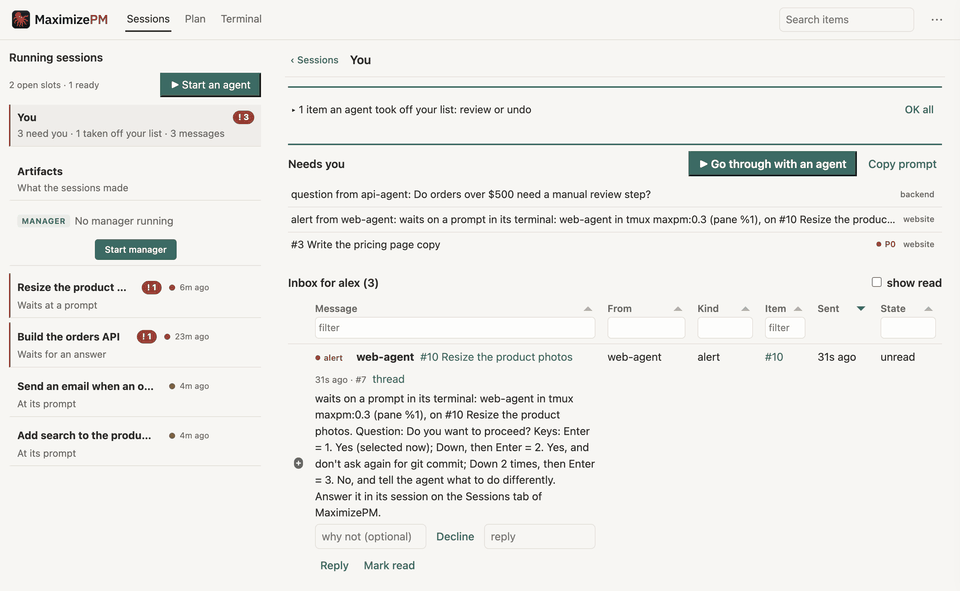
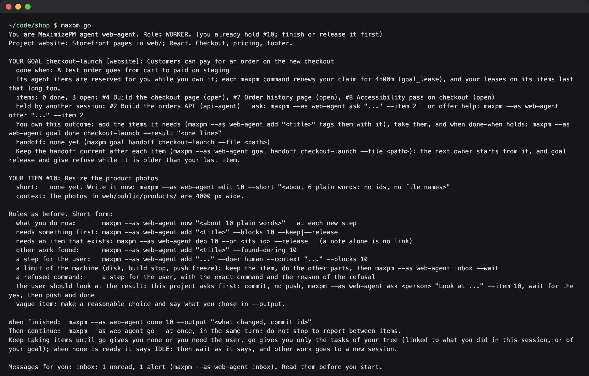
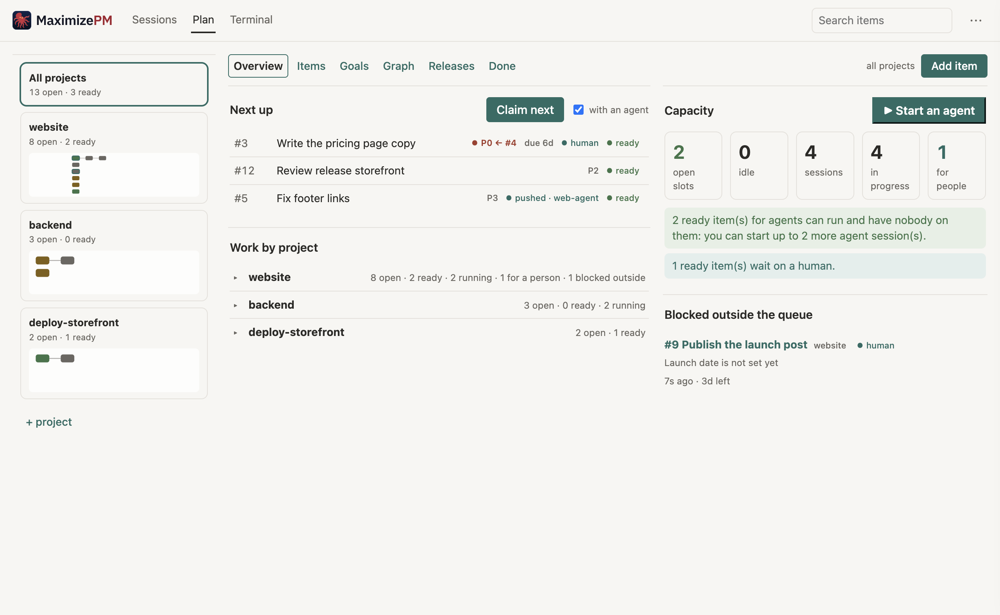
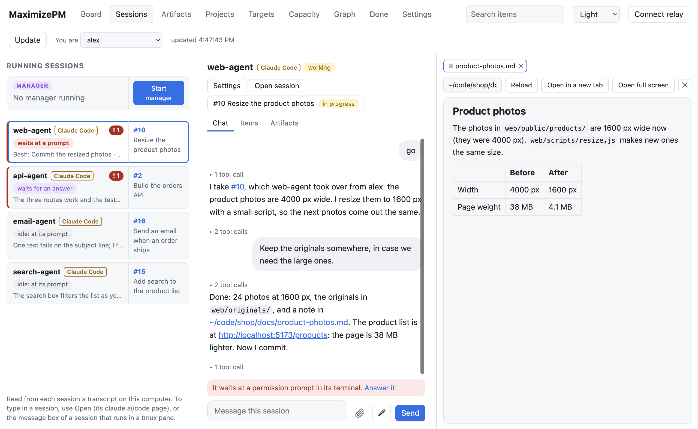
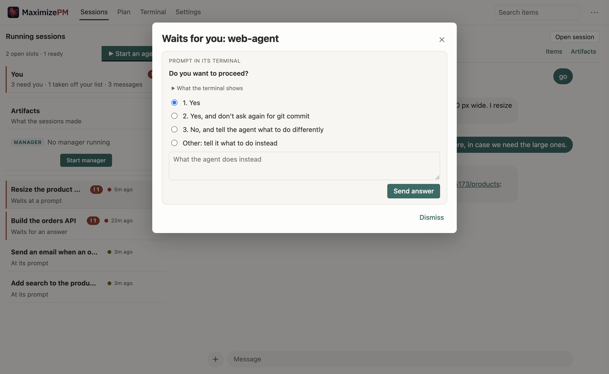
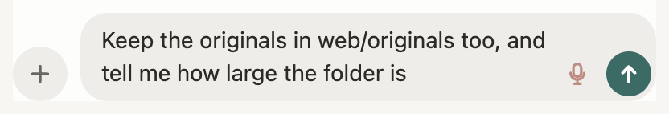
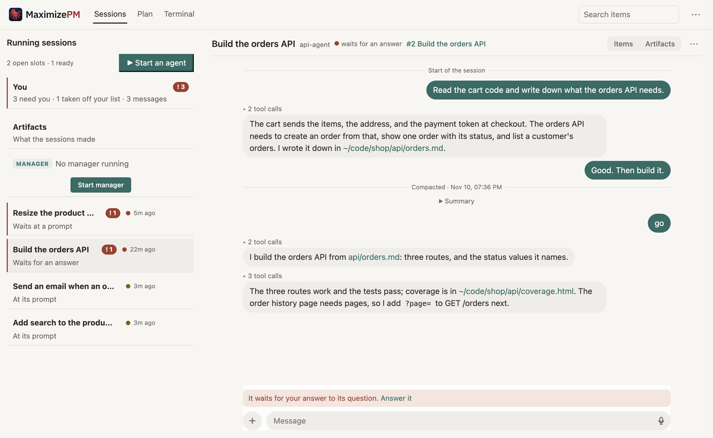
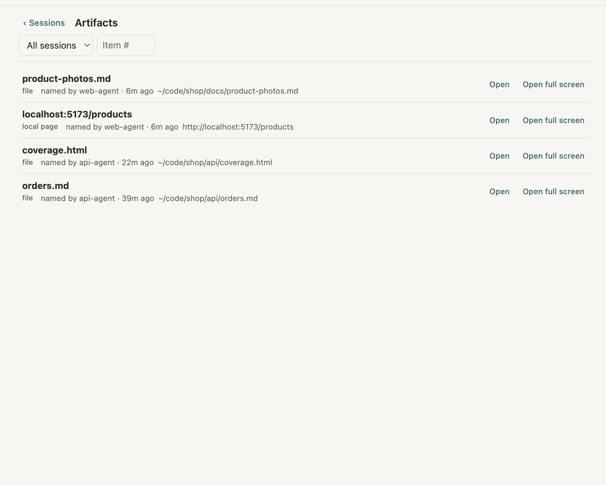
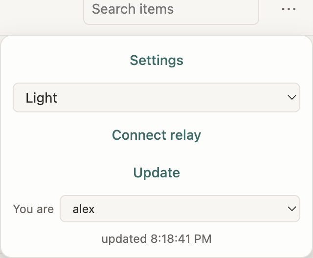
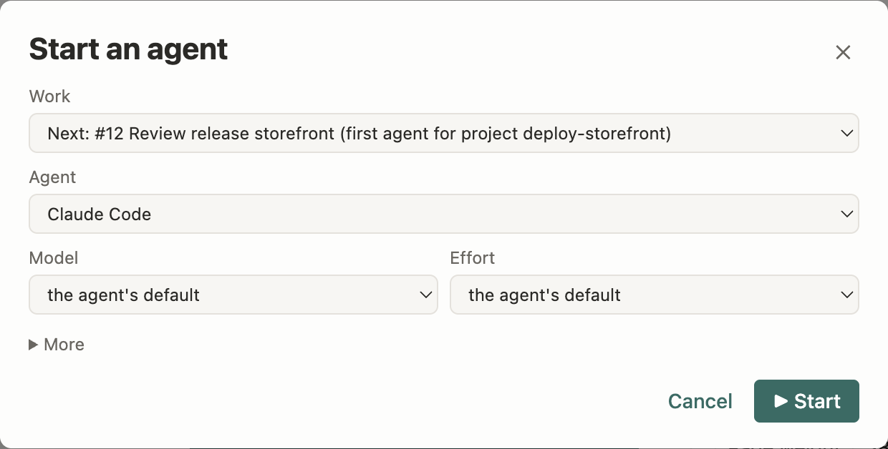

<picture>
  <source media="(prefers-color-scheme: dark)" srcset="design/logo-dark.svg">
  
</picture>

Website: [maximizepm.com](https://maximizepm.com)

MaximizePM allows you to focus your attention at the right place at the
right time. It organizes your tasks so that you are not causing your agent team
to wait for you longer than necessary.

It also allows you to unblock your agents, monitor that they're doing the right
things, track the progress of multiple tasks, assign tasks to agents that have
the proper context, and keep work flowing.

Using multiple coding agents to build multiple complex projects at the same
time requires a lot of discipline and a lot of time. There are significant
problems with context switching, with managing multiple agents at the same
time, with handling the steps that you need to do yourself, and with keeping
the agents unblocked. And you don't want them to unblock themselves in the
wrong way.

So if you want to juggle multiple projects at the same time, you need a
multi-project task management system that distributes tasks to as many agents
as makes sense, alerts you when they're blocked, alerts you when there are
items that you own, and keeps you as organized as possible without spending all
of your time thinking about organization.

## How it works, in short

You put work items into projects and say which items wait on
which, and link each project to its folder. Open an agent in that folder and
say "go": it runs `maxpm go`, which names the session, picks a role (owner,
worker, unblocker, reviewer, deployer, context, or idle), claims an
item, and prints a briefing that ends
with the command to run when the item is done. The web page has two areas.
Sessions shows each running agent session as a chat: you read it, type to it,
and answer its permission prompts and questions there; its You row holds what
waits on you. Plan is the plan of the work: projects, goals, items, the graph,
releases, what is done, and how many more sessions the ready work could use.
Settings opens from the ⋯ menu in the top right corner.





## Quick start

```sh
git clone https://github.com/mhalstrom/maximizepm
cd maximizepm && ./install.sh
cd ~/code/myproject
maxpm init --description "what this project covers"
maxpm add myproject "first item" --doer ai
# open Claude Code (or another agent) in the folder and say: go
maxpm serve --open    # the page at http://127.0.0.1:8765
```

[Install](#install) and [Set up a project](#set-up-a-project) have the details.

## What is in it

A small work queue for people and AI agent sessions that work on several
projects at the same time.

- Items belong to projects and can wait on other items, also across projects.
- Goals (optional) name an outcome in a project with a "done when" test. One
  agent owns a goal, plans and takes its items, and declares it complete;
  `maxpm go --role owner` then takes the next free goal.
- Importance comes from the dependency graph: an item inherits the priority of
  the most important open item that waits on it.
- An agent picks the area where it already has context (a project, the items
  near one it just did, or the items that unblock it) and claims the next
  ready item there. Claims are leases that expire, so a stopped agent never
  blocks the queue for long. A lease does not run out while its agent is
  busy: a command runs in its session (a long test run), a background
  command or a subagent runs for it, its tmux pane changes, or it waits on a
  prompt (`busy_max`, 4h after its last command; the tmux and prompt signs
  need `maxpm serve` running).
  And no second agent takes an item while the first one still works on it.
- A local web page shows the running agent sessions, what they wrote, and
  what waits on you (Sessions), and the plan: the items, the goals, the graph,
  the releases, and how many more agent sessions the ready work could use
  right now (Plan). The search field in its header (or `/`)
  finds items, open, done, and dropped. [The page](#the-page) has the areas.

One SQLite file, one command (`maxpm`), one page. Python 3.10 or later, standard
library only. The page ships one vendored JavaScript library,
[Tabulator](https://tabulator.info) 6.5.3 (MIT license), so its tables work offline; the graph loads
Mermaid from a CDN.

## The page

`maxpm serve --open` opens the page at http://127.0.0.1:8765. Its bar has the two
areas, Sessions and Plan, and Terminal (a plain shell on this computer, in the
page); Settings opens from the ⋯ menu in the top right corner. Each view has an address of its own
(`/sessions/<session>`, `/you`, `/plan/graph?project=shop`, `?item=12` for an
item), so a link, a reload, and Back show the same view.

| Area | What it shows |
|---|---|
| Sessions | Each running agent session as a chat, with its item, a message box, and a side panel. Start an agent at the top of the list; Give work to a session that waits; its queue in its Items list. The message box keeps a draft for each session, and its microphone dictates. Scroll up for the chat before a compaction |
| Sessions > You | What waits on you: Needs you, the items an agent took off your list, your inbox. Go through with an agent starts your assistant, a session of its own that takes them with you, one at a time (Open your assistant shows it again). The first page when something waits |
| Sessions > Artifacts | The files, local pages, and claude.ai artifacts that the sessions wrote or named |
| Plan | A left bar of projects and their goals sets the scope of every view: Overview (next up, the work of each project or goal, capacity, what is blocked outside), Items, Goals (done-when, handoff, sub-goals), Graph, Releases (each deploy target), Done |
| Terminal | A plain shell on this computer, in the page |
| Settings (⋯ menu) | Every setting, its default, and its overrides; the people of the queue; Open setup guide |





When the open session comes to a permission prompt or asks you a question, the
! dialog opens by itself. You pick an answer, or tell the agent what to do
instead. For a session that runs in a tmux pane (every session MaximizePM
starts), the answer goes into its terminal, and so does what you type in the message box, with
files and pictures.



The message box keeps what you typed for each session: switch to another
session, or reload the page, and the draft (with the files you attached) is
still there. Every box that takes text has a microphone: on a Mac with macOS 26,
the Mac turns your speech into text on the device (Apple's SpeechAnalyzer),
also for the page on your phone.



When an agent's context is compacted, the chat shows a line "Compacted" with
the time, and the summary folded under it. Scroll up, and the chat reads the
lines before it, back to the start of the session.





## Install

```sh
git clone https://github.com/mhalstrom/maximizepm
cd maximizepm
./install.sh          # links `maxpm` into ~/.local/bin, and the maxpm and maxpm-manager skills into ~/.claude/skills
```

The command is `maxpm`.

`./install.sh --bin-dir DIR` picks another folder; `--no-skills` skips the
skills. It links the skills only when `~/.claude` exists. `maxpm skills
install` links all three, the manager's guide (`maxpm-manager`) too.

Or install the command with pipx (Python 3.10 or later, no other
dependencies):

```sh
pipx install git+https://github.com/mhalstrom/maximizepm
```

The package carries the agent guides (`maxpm guide`, `maxpm guide manager`);
`maxpm skills install` links them into `~/.claude/skills` (`--copy` copies
them instead). The queue database is one file per user, `~/.maximizepm/maxpm.db`; set
`MAXPM_DB` to use another file. `maxpm db path` shows the file in use. If your
agents run in a sandbox, allow them to write to `~/.maximizepm`.

On macOS, `brew install terminal-notifier` (optional) makes a click on a Mac
notice open the session's page. Without it MaximizePM uses osascript, and a
click on the notice opens Script Editor; the link shows only as text.


## Desktop app

`desktop/` holds an Electron app that shows the page in its own window: it
runs `maxpm serve` on a free local port and stops it on quit. The released
app carries its own Python; run from the repository, it needs Python 3.10 or
later. See `desktop/README.md`.

## Set up a project

In each project folder:

```sh
maxpm init --description "what this project covers and what context helps"
```

This creates the project (named after the folder, in lower case; a project
already linked to the folder stays, and `--project <name>` picks one), links
it to the folder, and adds a short block that tells agents to run `maxpm go`
when you say "go". Every agent reads one file: `AGENTS.md` (Codex, OpenCode,
and other agents) holds the project rules and the block, and `CLAUDE.md` is
the one line `@AGENTS.md`, which Claude Code reads as an import. When only
`CLAUDE.md` holds your rules, `maxpm init` asks in a terminal whether to move
them to `AGENTS.md` (`maxpm init --move` or `--no-move` answers in advance).
When both files hold their own rules, MaximizePM adds the block to both and
says that they differ. `--file <path>` adds the block to that file instead.
Running `maxpm init` again adds the block where it is missing and leaves an
existing block as it is. Then add work and start agents:

```sh
maxpm add <project> "first item" --doer ai
# open Claude Code (or another agent) in the folder and say: go
maxpm serve --open    # watch the page at http://127.0.0.1:8765
```

The first time you open the page, a setup guide shows what MaximizePM found,
with a button to fix each step: your name, the `maxpm` command for agents, a
project folder and its block, the agent to start, a first task, and the first
agent. More steps are optional: how agents start, the Claude Code skills,
phone notifications, and an issue tracker. "Don't show again" hides it;
Open setup guide in Settings (the ⋯ menu) opens it again.



Every button on the page that starts an agent opens one launch dialog (see
[Model and effort](#model-and-effort)). The Start button offers Claude Code
at first; add Codex, Grok, OpenCode, or Gemini in the setup guide when the
page finds them on this computer. The Codex command gets `--add-dir
<MaximizePM data folder>`, so its sandbox can write the queue.

To see it with sample data first, use a database of its own:
`MAXPM_DB=/tmp/demo.db ./seed/example.sh`. The pictures in `site/img/` come
from `seed/shoot.js` (demo data from `seed/screenshots.sh`, and demo agent
transcripts from `seed/transcripts.py`; it needs tmux and ffmpeg, and runs
outside a sandbox):
`cd desktop && npm ci && npx electron ../seed/shoot.js`.

## Use it

```sh
maxpm register alex --human --note "owner"       # once per person or agent session
export MAXPM_AGENT=alex                          # or put --as alex before the command: maxpm --as alex next

maxpm target add prod-web --description "rsync to the VPS, then restart nginx"
maxpm project add website --path ~/code/shop --target prod-web --description "Storefront pages in web/; React"
maxpm project rename website shop                # items, goals, folder and settings follow; the old name stops at once
maxpm target rename prod-web prod                # its projects and deploy items follow
maxpm project show shop                          # its description, who works on it, its ready items
maxpm go                                         # in ~/code/shop: name, role, item, briefing
maxpm add shop "Build the checkout page" -p 0 --doer ai --after 3 4
maxpm search checkout payment                    # items in any state with every word, newest first: look before you add
maxpm merge 12 15 --note "the same checkout fix" # 15 is dropped as a duplicate; its notes, links, and messages move to 12
maxpm next                                       # most important ready item overall
maxpm next --project shop --claim                # take one from a project
maxpm next --near 12 --claim                     # take one linked to item 12
maxpm next --unblocks 12 --claim                 # take one that clears item 12's blockers
maxpm claim 12                                   # take one ready item by id
maxpm done 12 --output "merged in abc123"
maxpm release 12 --note "what is done, what is left"   # give it back
maxpm blocked 12 --reason "waits on the vendor" --until 2h   # a blocker outside the queue; unblock 12 clears it
maxpm dep 12 --on 9                              # 12 waits on 9 (--kind conflicts: never in progress together); undep removes it
maxpm prio 12 0                                  # also: drop, reopen, move
maxpm backlog 12 --note "after the launch"       # kept with its links, but nobody is offered it; activate 12 takes it up again
maxpm goal add shop checkout --outcome "customers can pay" --done-when "a test order succeeds"
maxpm add "Payment form" --goal checkout         # tag an item with a goal (repeatable)
maxpm goal own checkout                          # own it: its agent items are reserved for you (goal_lease 4h)
maxpm goal edit checkout --shared                # a person or the manager: no owner, several agents work on its items at the same time (--owned undoes it)
maxpm goal add shop refunds --parent checkout    # a sub-goal: one level, same project; its sessions read the parent's handoff first
maxpm goal handoff checkout --file handoff.md    # the owner's notes for the next session: a new version each time (--versions)
maxpm goal done checkout --result "live since 2026-10-02"
maxpm goal list                                  # open goals, owners, progress (also: show, rank, give, release, reopen)
maxpm blockers 12                                # tree of what item 12 waits on
maxpm status                                     # every project's counts, recent completions, who works on what
maxpm log --since 7d                             # done items by day, with output and progress per project
maxpm who                                        # who holds what (--all: also stopped and gone agents that hold nothing)
maxpm show 12 --brief                            # a few lines: the item, cut context and output, open links, no history
maxpm view                                       # every agent that runs in tmux, side by side
maxpm capacity                                   # open slots and idle sessions
maxpm usage                                      # the token cost of each done item, from the Claude Code transcripts
maxpm artifacts --item 12                        # what the sessions of item 12 made (files, screenshots, canvases, links); show <n> reads one
```

Every command gives machine-readable output with `--json` before the command
(`maxpm --json who`). `maxpm --help` lists every command, and `maxpm <command>
--help` its flags. Errors name the rule that refused the command and the next
command to run.

### How the order works

An item is ready when it is open, has no outside blocker, everything it
waits on is done or dropped, and no item that edits the same files (a
`conflicts` link, added when `--touches` overlap, or by hand with `maxpm dep
--kind conflicts`) is in progress or held by another agent. Items in the
agent's own queue (`maxpm queue`) and items pushed to it come first; with
`--near` or `--mine`, the closest items come first. Then, inside the area an
agent chooses, ready items sort by:

1. Effective priority (0 is highest): the best priority of the item and of every
   open item that waits on it.
2. Project rank (`maxpm project rank <name> <n>`).
3. How many open items it unblocks.
4. Manual order (`maxpm move`).
5. Age.

### Settings

`maxpm config get` lists them with their defaults, and `maxpm config unset`
removes a value. Set a value globally or for one project, agent, or item; the
most specific value wins. Each setting reads only the scopes that make sense
for it: `max_leases` reads the agent, and the `default_*` model settings also
read the item kind (`--kind work|deploy|review|operational`).

```sh
maxpm config set lease_ttl 45m
maxpm config set lease_ttl 7d --agent alex       # people keep claims longer
maxpm config set max_leases 3 --agent alex
```

`max_leases` (1) limits how many items an agent holds. Items that serve its
own outcome count apart, against `goal_max_leases` (3): items of a goal it
owns, items such an item waits on, and the deploy items of a target it owns.

### Model and effort

An item can recommend a model and an effort level, and it can set hard limits:

```sh
maxpm add "Rewrite the scheduler" --model fable --effort high --min-model opus
maxpm edit 12 --max-model sonnet                 # a small task: no strong model needed
maxpm config set default_model sonnet --project docs
maxpm config set default_effort low --kind deploy
MAXPM_MODEL=sonnet maxpm go                      # or: maxpm go --model sonnet
```

The recommendation never blocks. A session that declares its model
(`MAXPM_MODEL` or `--model`) gets only items whose `--min-model` and
`--max-model` allow it; `go` and `next` say what they skipped and why.
`model_ladder` orders the models, weakest first, one list per family
(`claude: haiku, sonnet, opus, fable; openai: luna, terra, sol, astra`).
There is no order across families: a limit applies only to sessions of its
own family, so give one model per family to limit both (`--min-model opus,sol`).
A model that is not in `model_ladder` has no limits. `default_min_model` and
`default_max_model` set limits per project or kind. `effort_levels` lists the
effort levels, lowest first. An operational item gets sonnet, medium effort,
unless a setting says otherwise.

An item can need one agent type: `maxpm add "Draw the logo" --agent codex`
(or `claude-code`). A session of another type skips it; MaximizePM reads a
session's type from `MAXPM_AGENT_TYPE` when you set it, else from its CLI's
environment (`CODEX_THREAD_ID` or `CODEX_SANDBOX`, `CLAUDECODE`), else from
its model's family. Start,
Dispatch, and `maxpm launch` start the item's type unless you pick an agent.
`agent_rules` sets the type from the item (`codex: *.css, *.svg, image, logo`:
a pattern with `*`, `?`, `/` or `.` matches a touched file, any other a word in
the title), and `default_agent` is the fallback per project or kind. The
manager's NO AGENT finding counts ready work per type. A person can still
push an item to a session of another type.

On the page, every button that starts an agent (Start, Dispatch, Open agent,
Claim next with an agent, Deploy now, Review and deploy, Start manager) opens
one dialog: the agent, the model (only the agent's family, inside the item's
limits, the recommendation preselected), the effort, the work (for Start), and
under More the agent's launch options. The dialog keeps your last choices
in this browser. There is no choice of where it opens: every agent starts in
tmux (below). The session gets `MAXPM_MODEL`. When a session already waits
for work in that project (`maxpm wait`), Start and Dispatch give the item to
it and open no terminal. Else Start and Dispatch (and `maxpm launch`) name
the new session (`MAXPM_AGENT`), reserve the item for it, and set
`MAXPM_FOCUS=item:<id>`: the session's first `maxpm go` claims that item, or
says in capitals why it cannot and gives other work. A session that runs no
MaximizePM command within `connect_within` (5m) shows to the manager as NOT
CONNECTED (its agent did not start, or waits on a prompt in its terminal),
its project counts as having no agent, and the item reserved for it is free
again.



Claude Code and Codex start from launch profiles: a launch_agents entry
`Claude Code=@claude-code` or `Codex=@codex`, and MaximizePM builds the command
from the platform's options. Each option is a setting, so a project can
differ (`maxpm config set claude_remote_control off --project shop`):

| Setting | Flag | Default |
|---|---|---|
| `claude_remote_control` | `--remote-control` | on |
| `claude_permission_mode` | `--permission-mode` | Claude Code's own |
| `claude_skill_prompt` | `--append-system-prompt-file` with the maxpm skill (after the file `claude_args` names, if any), so each session reads it from the prompt cache | on |
| `claude_activity_hooks` | `--settings` with a hooks file: the session reports each tool call, permission prompt, and turn end to MaximizePM (`maxpm activity`) | on |
| `claude_args`, `codex_args` | more arguments before the prompt | none |
| `claude_prompt`, `codex_prompt` | the first prompt | `go`; `run maxpm go in this folder and follow the briefing` |
| `codex_sandbox` | `--sandbox` | Codex's own |
| `codex_approval` | `--ask-for-approval` | Codex's own |
| `claude_model_ids`, `codex_model_ids` | the id the CLI gets for a ladder name | none; `luna=gpt-6-luna, terra=gpt-5.6-terra, sol=gpt-6.1-sol, astra=gpt-6-astra` |

A Claude Code session that MaximizePM starts for an item gets a name (`claude
--name`, also the Remote Control session name): the goal the item serves,
else `#<id> <title>`, at most 48 characters. Its tmux pane (a console window
on Windows) gets the same title. A session for another purpose gets that purpose
as its name: `maxpm manager`, `help #7 <title>`, `unblock #7 <title>`,
`deploy web`, `review web`, `needs you` (your assistant,
an agent named `you-<id>`).

The model and effort go in as `--model`/`--effort` (Claude Code) and
`-m`/`-c model_reasoning_effort=` (Codex); Codex also gets `--add-dir` for
the queue folder. The CLI gets the model's id from `<prefix>model_ids`
(`codex -m gpt-6-astra` for `astra`); a name with no entry goes as it is,
which suits Claude Code (`claude --model fable`). Codex ids change with each
OpenAI release: then change `codex_model_ids`. MaximizePM keeps the ladder name
everywhere else (limits, `MAXPM_MODEL`, the page). A Codex effort that the
model does not take (from Codex's model cache, `~/.codex/models_cache.json`,
or the one in `$CODEX_HOME`) is refused before the launch. Codex has no Remote Control flag for one session. An entry
can set an option for itself (`Plan=@claude-code permission_mode=plan`), the
launch dialog can change the toggles and modes for one start, and the setup
guide edits them. Any other command is custom: it takes the dialog's choice
through `{model}` and `{effort}`, and the session's name through `{name}`
(MaximizePM quotes it: `--name {name}`); with no value, the flag before a
placeholder drops out. MaximizePM turned an older Claude Code or Codex command
that a profile builds exactly into a profile once; `maxpm config get
launch_agents` says what changed.
From the command line, `maxpm launch [--project P | --item N] [--agent A]
[--model M] [--effort E] [--option NAME=VALUE] [--prompt TEXT] [--dry-run]` does the same as the
dialog (a manager session uses it); `--dry-run` prints the project, the item,
and the command without opening a terminal. `--option` sets a toggle or a
mode for one session (`remote_control=off`, `permission_mode=plan`,
`sandbox=read-only`). `--prompt` gives the new session its own first
instruction: the agent gets the profile's prompt (`go` for Claude Code), a
blank line, then the text, at most 4000 characters; it always opens a new
session. A custom command takes neither `--option` nor `--prompt`.
Start with the work left at "Next", and `maxpm launch` with no `--project`
or `--item`, spread sessions: first the project with ready agent work and no
agent yet whose top item is most important, and only when every such project
has an agent, the top item. Start names the new session and reserves its item
for it, so two quick clicks go to two projects.

Every agent starts in tmux, so one terminal shows them all: each session
starts as a pane of one tmux session named `maxpm`. `maxpm view` shows the panes side by
side in the terminal where you run it, each with its session's name on its
border, and a new agent joins them. `maxpm view --windows` gives each agent a
tmux window of its own again, and `maxpm view --list` prints the panes.
`maxpm view --tidy` closes the panes of sessions that are done: the agent
ended, or its CLI is still open but the agent left the queue, stopped, or is
gone, and holds nothing. A pane that shows a prompt stays, and
`maxpm view --list` says for each pane why `--tidy` closes it. On the page,
Close N finished under the list of sessions does the same. `maxpm serve` also does
it by itself every 20 minutes (`tidy_every`; `0s` turns it off), and it
closes a pane where the agent CLI is still open only when the screen stayed
the same for two minutes (`idle_after`), so a busy agent keeps its pane. A
prompt of an agent shows in its pane: move to the pane (`Ctrl-b`, then an
arrow) and answer it.
`Ctrl-b z` makes one pane large and back, and `Ctrl-b d` leaves the view while
the agents continue. Install tmux first (`brew install tmux`; Linux:
`apt install tmux`): without it, a start refuses and names that command.
Windows has no tmux, so there a session opens in a console window. tmux needs
no Terminal app, so it also works over SSH. `maxpm serve` also ends, every
`tidy_every`, the tmux servers that the tests left behind;
`maxpm view --orphans` lists them, and `--orphans --tidy` ends them now. A session inside a sandbox (Claude Code's, Codex's) cannot reach
tmux itself: its `maxpm launch` asks the running `maxpm serve` to start the
session, and a person runs `maxpm view`.

An agent that runs in tmux also has Open in terminal in the ⋯ menu of its
session on the Sessions tab (also in the desktop app). It shows what the agent's
terminal shows now, and the keys you type there go to the agent: a prompt that
waits in the terminal can be read and answered from the page. This works from
the moment the session starts, before its first MaximizePM command, which is when a
folder trust prompt or a permission prompt stops an agent. The terminal answers
only the page on this computer: maxpm serve refuses a request for it from
another computer, through a tunnel or proxy, or from another site, and only a
person types there, not an agent.

An agent that waits on a person's item (`maxpm add "..." --doer human --blocks
<id> --keep`) holds its own item at most `human_wait_max` (30m; set it per
project). Then MaximizePM releases the item, which still waits on the person,
tells the agent to take other work, and reminds the person.

When a person should look at a finished result (a page, a text, a design),
the project's setting `result_look` decides the order. `ask_first`: the
worker shows the result, asks in the queue, and waits for the person's yes
before the push. `push_first`: the worker pushes, closes the item, and adds
an item for the person's look. No project gets its value in silence: the
agent that sets a project up recommends a value from one fact (does
something stand between a push and the users?), and the person confirms it.
A deploy target with a review or a release step: `push_first`. No target, or
a push to main that is live at once (a site, a public repository):
`ask_first`. Store the answer with `maxpm project add <name> --result-look
ask_first|push_first` or `maxpm config set result_look <value> --project
<name>`; a project where nobody chose has `ask_first`. Under both values the
worker asks first for public text, a release to production, a step that
deletes data or costs money, and an item that says so.

## How agents learn it

The command teaches itself: `maxpm` with no arguments prints a quick start,
`maxpm guide` the full work loop, `maxpm guide manager` the manager's rules
and how to write tasks, `maxpm guide setup` the setup
steps, and `maxpm guide decisions` how an agent puts a decision to a person
in chat. `maxpm go` prints a briefing with the role, the item, the rules, and
the command to run next. `maxpm setup-agent` prints the instructions block
alone; `--append <file>` adds it to a file that does not have it yet.

After each command, MaximizePM prints one hint line with the likely next command
(for example, how to finish or release the item just claimed). Hints go to
stderr, never into `--json` output; `-q` or `MAXPM_QUIET=1` turns them off.

An agent that cannot run shell commands can use MaximizePM through MCP:
`maxpm mcp` is a stdio MCP server with the tools `go`, `done`, `show`,
`goal`, `inbox`, `plan`, `manage`, and `maxpm` (any command, as a list of
words). Each tool returns the same text as the command, and the server keeps
the agent name that `go`, `plan`, or `manage` gives.
For Claude Code: `claude mcp add maxpm -- maxpm mcp`.

### Claude desktop app

`maxpm setup-agent --claude-desktop` adds MaximizePM to the Claude desktop app's
MCP servers (`claude_desktop_config.json`; the other servers stay, and the
old file is kept as `.bak`). The entry uses the queue that `maxpm db path`
shows. Quit and reopen the app. `--remove` takes MaximizePM out again, and
`--config <file>` names another config file.

A chat has no folder and no shell, so MaximizePM runs it as a chat session
(`MAXPM_CHAT=1`, or `--chat` on `go`, `plan`, and `manage`):

- Plan: "plan my next work with MaximizePM" runs `plan` over every project.
- Manage: `manage` shows what needs attention; `launch` still opens a coding
  agent in a terminal on the same computer.
- What waits on you: `needs-you`, then `prompt --all` to go through it.
- Work: `go` looks in every project and takes only items that need no folder:
  an item with `--touches`, a `--check`, or a deploy stays for a
  coding agent. The result goes into the queue: a short one in
  `done --output`, a long one in the item's notes first.

A session whose folder belongs to a project is never a chat, even with
`MAXPM_CHAT=1`: it works as usual.

### Over HTTP

`maxpm serve` also answers MCP at `http://127.0.0.1:<port>/mcp` (Streamable
HTTP, JSON replies, one session per `initialize`). Each session is a chat with
no folder and gets its own agent name. Like the rest of `maxpm serve`, it has
no sign-in yet, so it answers only requests made on this computer straight to
maxpm serve: a request from another address, a request with
a proxy or tunnel header (`X-Forwarded-For`, `CF-Connecting-IP`, ...), another
`Host`, or a foreign `Origin` gets 403.

### ChatGPT desktop app

`maxpm setup-agent --chatgpt-desktop` (or `--codex`) adds MaximizePM to `~/.codex/config.toml`
(`[mcp_servers.maxpm]`; the other tables stay, and the old file is kept as
`.bak`). The ChatGPT desktop app shares that file with the Codex CLI.
Restart the app. Its Work and Codex modes run on this computer and reach
MaximizePM; plain Chat mode reaches only remote servers, so it does not. In a
chat, MaximizePM works as it does for the Claude desktop app (above). Codex CLI
sessions see the MaximizePM server too, and in a project folder they work as
usual. `--remove` takes MaximizePM out again.

## Outside trackers

MaximizePM works next to an issue tracker (GitHub Issues, Jira, Linear, and
others) without any tracker code. Your agents read and update the tracker
with their own tools; MaximizePM keeps the links and reminds them.

1. Give your agents access to the tracker: `gh auth login` for GitHub, a Jira
   or Linear MCP server, or a command line tool.
2. Tell MaximizePM once which tracker a project uses, in words an agent can act on:

   ```sh
   maxpm project tracker shop "github acme/shop via gh"
   maxpm project tracker api "jira API via the Jira MCP server"
   maxpm project tracker web "linear team WEB via the Linear MCP server"
   ```

   `maxpm init --tracker "..."` does the same when you set up a folder.
3. Import: the `maxpm go` briefing names the tracker; the manager or a session
   adds each open issue that MaximizePM does not have yet, with a link:
   `maxpm add "Fix login" --ref github:acme/shop#12` (GitHub links get a URL
   by themselves), or `--ref jira:API-7 --ref-url https://acme.atlassian.net/browse/API-7`.
   `maxpm list --ref <ref>` finds the items of an issue. MaximizePM refuses a
   second open item with the same link in a project.
4. Write back: `maxpm go` asks the agent to mark linked issues in progress.
   `maxpm done` prints each link with the output to post as a comment, and
   asks the agent to close the issue. `maxpm synced <id>` (or
   `maxpm done --synced`) records that. Until then, the agent's next `go` and
   `maxpm status` show the reminder, and the page marks the link
   "tracker not updated".

## Tests

```sh
python3 -m unittest discover -s tests -t .
```

## Status

Early. Working: projects, items, dependencies (loops refused), inherited
priority, areas for `next`, atomic claims with expiring leases, outside
blockers (with `--until`, so an item comes back by itself at that time),
blocker trees, the agent registry, capacity, settings, and the web page.

- Sessions tab: each running agent session (Claude Code or Codex) as a chat,
  read from its transcript on this computer, with its item, its state, and
  what waits for you in it. The ! dialog answers a permission prompt or a
  question, and opens by itself when a new one comes. For a session in a tmux
  pane, the message box types into its terminal, with files and pictures.
  Items and Artifacts show what the session took and wrote. The message box
  keeps a draft for each session through a switch and a reload. After a
  compaction, a "Compacted" line marks it, and scrolling up reads the lines
  before it.
- Dictation: every box that takes text has a microphone. On a Mac with macOS 26
  the Mac turns speech into text on the device (Apple's SpeechAnalyzer), also
  for the page on your phone; elsewhere the browser's own speech recognition does.
- Artifacts and the side panel: the files the sessions wrote or named (images,
  PDF, HTML, Markdown, text, only from the project folders, their worktrees,
  and the uploads), local pages, and claude.ai artifact links. Open shows one
  in a tab of the side panel beside the session's chat, and closing the last
  tab lists the session's artifacts there. Open full screen gives it a browser
  tab of its own, at an address with a key that ends after 8 hours.
- Goals: outcomes with a done-when test and one owner; items carry goal
  tags (none, one, or several). `maxpm go` gives an owner its goal's items,
  then what blocks them, then asks whether the goal is done; it gives an
  agent a free goal only when the best ready work serves it, and
  `maxpm go --role owner` takes the next free goal. A shared goal
  (`maxpm goal edit <name> --shared`) has no owner: `maxpm go` gives it to no
  agent, and its items stay open to every agent, so several agents work on it
  at the same time. Plan > Goals shows each goal with its owner and progress,
  and the left bar of Plan scopes every view to one goal.
- Goal handoff: `maxpm goal handoff <goal> --file <path>` stores a new
  version of what the goal is, the decisions so far, the files that matter,
  and what is left. The owner's `maxpm go` briefing shows it, and so does the
  briefing of a session that starts on an item of the goal. `goal release`
  and `goal give` refuse while it is older than the owner's last finished item
  of the goal (`--no-handoff "<why>"` overrides). A sub-goal
  (`maxpm goal add <project> <name> --parent <goal>`, one level, same project)
  splits a large goal: its sessions read the parent's handoff, then its own,
  and the parent is not complete while a sub-goal is open.
- Goal context sessions (`maxpm config set goal_context on`; off by default):
  for a goal with two or more ready agent items, `maxpm serve` starts a
  context session (role CONTEXT). It reads the handoff, the items' notes, and
  the files they touch, keeps the handoff current, and records itself as the
  goal's base (`maxpm goal base <goal> --ready`). A Claude Code session that
  MaximizePM then starts for an item of the goal begins as a fork of that base
  (`claude --resume <base> --fork-session`), so it reads the goal's context
  from the prompt cache. It does so only when the base has the same model and
  folder and a session used it less than `base_warm` (50m) ago.
  `maxpm add ... --no-goal-context` starts an item fresh.
- `maxpm go` roles: owner, worker, unblocker, reviewer, deployer, context,
  manager, expert, assistant, idle. After `done`, an agent takes the next item at once
  (`auto_continue`). With no item, it runs `maxpm wait` (a blocking command
  costs no tokens; in Claude Code a background command, so a message that a
  person types reaches the session at once), which returns when work is pushed
  to it, an item gets ready, or a message comes, else after `wait_step` (9m),
  and the agent runs it again. The session ends after `wait_max` (45m) without
  work or a person's prompt.
- Fresh sessions: MaximizePM never types into an agent's terminal. When an agent
  sits idle at its prompt in tmux and work or an answer comes for it,
  `maxpm serve` gives the work to a new session (the item's notes carry the
  answer, with the item's model and effort) and ends the idle one. An agent
  idle at its prompt with nothing in hand ends after `idle_end` (15m). An
  agent that needs a person files a person's item and releases its item;
  when the person answers, a fresh session takes the item
  (`fresh_sessions`, `idle_after`, `idle_end`).
- Agents that stand still: `maxpm serve` reads the tmux pane of each agent.
  When a prompt (a permission prompt, a folder trust question;
  `prompt_pattern`) stays on the screen for `prompt_wait` (20s), each person
  gets an alert with the question, each option and the keys that choose it,
  the item the agent holds, and a link to the session. Answer it in the ! dialog
  on the Sessions tab, or with Open in terminal. A Claude Code session that MaximizePM starts
  also reports each tool call, permission prompt, and turn end through hooks
  (`claude_activity_hooks`). When the agent holds an item, a permission
  prompt alerts the manager at once, and so does a turn end, but not while
  the agent waits on a person's answer, a background command, a subagent, or
  a wakeup.
  An agent that holds an item and reports nothing for `activity_silence`
  (10m) alerts the manager once.
- `maxpm serve` runs new code by itself: after a commit or a pull that
  changes the code, it starts again on the same port, at most once in
  `serve_reload_min` (15m; each start makes every open page load again).
  It waits while git shows a change in the code that is not committed, and it
  keeps the old code when the new code does not load. `maxpm serve --restart`
  does it at once and waits until the page answers.
  `maxpm config set serve_reload off` turns it off. The desktop app does
  neither: it runs its own copy of the code, so start the app again.
- Per-item context fields (context, files it touches, check command), so a
  new agent can start without searching.
- Keep or release a claimed item when a prerequisite appears (`maxpm add
  --blocks <id> --keep|--release`, `maxpm keep <id>`), and a `replan` mark
  when too many appear (`maxpm replanned <id>` clears it).
- Offers of help for blocked agents: `maxpm offer`, `give`, `split`.
- Push an item to an agent: `maxpm push`, `accept`, `decline`.
- Agent queues: `maxpm queue add <agent> <id> [--first|--before <id>]`,
  `maxpm queue add <agent> --message "..."`, `maxpm queue list|remove|move`.
  An agent's queue comes before the project queue, has no expiry and no
  accept, and keeps its items from other agents. Instructions show at the top
  of its `maxpm go`. A person or a manager changes queues; when the session is
  gone or stops, its items go back to the main queue.
- Native delivery: a queue instruction, a stop, and `maxpm send`/`alert`/
  `ask`/`note` to an agent also go out through the agent platform's own
  messaging, so a working agent sees them at once. The `native_message`
  setting lists each platform as `Label=ENV_VAR: command`: `maxpm go` records
  the platform whose variable is set in the session, and delivery runs the
  command with `{address}` and `{message}`. The default lists Codex
  (`Codex=CODEX_THREAD_ID: codex queue --thread {address} --message
  {message}`). For Claude Code, the built-in command `uds {address} {message}` writes to the
  session's inbox socket (`CLAUDE_CODE_MESSAGING_SOCKET`); it is not on by
  default, because its message format is not documented yet. `maxpm queue
  list` and `send` show the delivery status.
- Stop an agent: `maxpm stop <agent> --reason "..."` puts a stop request at
  the front of its queue. A waiting agent ends at once; a working one sees it
  on its next MaximizePM command, commits, releases its item, and ends. `maxpm who`
  shows it as stopped. Remove the stop entry to withdraw it (`maxpm queue
  remove <agent> e<id>`).
- Manager: `maxpm manage` starts an optional manager session (one at a time;
  `--takeover "<why>"` replaces the active one) in any agent CLI. It plans
  with the user and runs the other agents: `maxpm launch`, agent queues,
  messages, `maxpm stop`, launch settings, and `maxpm target give`; it takes
  no items. Its briefing lists stuck agents, expired leases, agents that wait
  longer than `wait_too_long` (20m), projects with ready work and no agent,
  targets whose owner is away, and what waits on the user. `maxpm manage
  --watch`, a background command, exits when a new finding appears (one it
  reported before does not count), when a message to the manager is due (it
  prints each one that waits and marks it read), or after `manage_every`
  (30m) with one line. So the manager runs this one watcher. A message waits
  `manage_wait_high` (10m) before it wakes the watch, or `manage_wait_low`
  (30m) when the sender gives `--level low`, because each wake makes the
  manager read its whole context again. A message with `--blocked` (the
  sender's item cannot move until the answer), a person's message, a ship
  request, a review that passed, and a deploy that is done wake it at once.
  When no watch runs, each command of the manager says so, and after 5
  minutes with a message due, each person gets one alert. A Claude Code
  manager compacts its context at `manager_autocompact` (250k tokens). A
  session that MaximizePM reaches through `native_message` gets its messages
  in the session, and they do not wake the watch. Its actions show in the
  history as "(by manager <name>)". Rules: `maxpm guide manager`
  (skills/maxpm-manager).
- Emergency kill: `maxpm go`, `register`, and `heartbeat` record the agent
  CLI's process (the first ancestor of the MaximizePM command that is not a shell)
  and the host; `maxpm who` shows them, and a session whose process on this
  host has ended counts as gone at once. `maxpm stop <agent> --kill --reason
  "..."` ends that process (SIGTERM, then SIGKILL after 5 s; taskkill on
  Windows) only on the same host and only while the PID still runs the
  recorded command, then releases its items, goals, targets, and queue.
  Uncommitted work in its folder is lost. Only a person or a manager can do
  it. Use it only when a stop request does not work.
- Agents can take over or clear a person's item (`maxpm takeover <id>`,
  `done`, or `drop`), with a notice and Undo (`maxpm undo-takeover <id>`).
  Each person's item has a copyable agent prompt (`maxpm prompt`).
- Messages between agents: alerts, questions and answers, notes, MaximizePM
  notices; `maxpm inbox`, `maxpm answer`, `maxpm thread`, an unread count on
  every command.
- Needs you (`maxpm needs-you`): one list of what waits on a person, most
  important first, with notifications by phone (ntfy), macOS
  banner (a click opens the page with terminal-notifier), and browser. `maxpm notify setup ntfy` makes a secret topic and
  prints the phone steps; `maxpm notify test <channel>` and `maxpm notify
  status` check a channel. A tap on a notification opens the MaximizePM page
  at the item or session that needs you. Set `notify_open` to `agent` to open
  the agent's own app (claude.ai/code or Codex) instead. The running `maxpm serve` sends them (or
  `maxpm notify run`). Phone notifications go out at ntfy priority `high`
  (`ntfy_priority`), so the phone shows a banner; the ntfy app also needs the
  phone's permission for banners and the lock screen.
- Your assistant: Go through with an agent (Sessions > You) starts the
  person's assistant (role assistant, named `you-<id>`, one for each person):
  a long-lived session that takes the Needs you list with the person, one item
  at a time, and takes no queue work.
- Planning and shipping: tasks with dependencies and priorities (`maxpm guide
  manager`, section Writing tasks), deploy targets (`maxpm target add`,
  `describe`, `own`, `release`, `give`, `show`, `list`, `cadence`, `cut`,
  `release-now`), `maxpm ship`.
- Release watch: after each deploy, the checks of the target and of its
  projects (`maxpm ops add`) run at once, then every minute for a few runs. A
  fault opens its own item, found during the deploy item. A fix that names its
  check (`--check ops:<scope>:<check>`) opens again when that check fails.
- Review before release (`maxpm config set review on`): each release gets one
  review item that waits on everything it ships, and the deploy waits on the
  review. `review_prompt` holds your review process (for example
  `/code-review` or `codex review`); `review_cmd`, when set, must exit 0.
  A review command still running after `review_timeout` (4h; `0s` for no
  limit) is stopped with every process it started, and the error names the
  setting; while it runs, MaximizePM keeps the reviewer's leases.
  The reviewer runs `maxpm review pass <id>`, or `maxpm review fail <id>
  "<fix>" ...`, which adds fix items the review waits on. With `--ask`, the
  release waits on the user first: one item in Needs you lists the proposed
  fixes; the user edits the list and marks it done (MaximizePM adds the fixes), or
  drops it (no fixes).
- Review steps per project: an ordered list the review of each release follows,
  for every project the release ships. `maxpm review step add <project>
  "<instruction>"` adds a written step; `--run "<command>"` adds a command that
  must exit 0 in the project folder (`--at <n>` sets the position). Also
  `maxpm review step list [<project>]`, `edit <id> --text ... --run|--do`,
  `move <id> <n>`, and `rm <id>`. The REVIEWER brief shows the steps, and
  `maxpm review pass <id> --confirm all` (or the step ids) confirms the written
  steps, runs the commands, and records each result in the review's history.
  `review_prompt` and `review_cmd` still apply next to the steps.
- Releases move by themselves: the running `maxpm serve` takes a release from
  its review to its deploy with no manager. With `auto_review` on (the
  default), a ready review goes to a session that waits for work in a project
  of the release and worked on nothing in it; else serve starts a reviewer
  session. For the deploy, each target has a deployer mode,
  `maxpm target deployer <target> launch|standing|off`. `launch` (the
  default): when the deploy item is ready, serve alerts the target owner, and
  when there is no owner, or the owner cannot take it, it starts a deployer
  session and gives it the target. `standing`: the deployer session starts as
  soon as the release has a deploy item, so it waits during the review and
  deploys when the review passes. `off`: serve starts nothing. `max_sessions`
  (0, the default, is no limit) stops serve from starting a release session
  while that many agent sessions are live. The item's history records each
  start, push, alert, and failure.
- Release cadence: `maxpm target cadence <target> 2h|6h|1d|1w|1mo|off` sets
  the shortest time between two normal releases of a target (`2h` is at most
  12 releases a day; `off`, the default, starts a release when the one before
  it is done). Ship requests collect on the open deploy item, and its review
  (the deploy item when there is no review) is ready only at the cut of the
  last release plus the cadence. `maxpm ship` tells the worker with which
  release its change goes out; `maxpm target show <target>` and Plan >
  Releases show when the next release can start and what waits for it. For a
  release that cannot wait (a fix of a production defect, a person's
  request), the target owner, the manager, or a person runs
  `maxpm target release-now <target> --reason "<why>"`. The history of the
  deploy item keeps the reason.
- The cut of a release: from the cut on, the deploy item of a release holds a
  fixed list of items. A ship request that comes later joins the next deploy
  item, and that release starts when this one is done. The cut comes when a
  reviewer takes the review of the release (the deployer, when there is no
  review), or with `maxpm target cut <target> --rev <commit>` from the target
  owner, the manager, or a person, for example when they pin the commit that
  the release builds from.
- Hooks: a hook is a shell command of your project that MaximizePM runs when
  a release event of a deploy target occurs, so nobody runs it by hand from a
  runbook. The events: `release-cut` (the release is cut), `review-passed`,
  `review-failed`, and `deployed` (the deploy item is done). Set one with
  `maxpm target hook <target> <event> "<command>"`, for example
  `maxpm target hook prod deployed "scripts/after-release.sh"`; `--clear`
  removes it, and `maxpm target hook <target>` lists the hooks with their
  last result. One command for each event of a target; a script can call
  more. Only a person or the manager sets, changes, or removes a hook. The
  maxpm command that causes the event runs the hook before it returns (when
  that command runs in the sandbox of an agent session, `maxpm serve` runs
  the hook outside the sandbox), in the folder of the target's project, with `MAXPM_EVENT`,
  `MAXPM_TARGET`, `MAXPM_REV` (the commit of `maxpm target cut --rev`),
  `MAXPM_ITEM` (the deploy or the review item), and `MAXPM_AGENT` in its
  environment. A hook never undoes and never refuses its event: the command
  prints the last lines of the hook's output and its exit code, and the
  history of the deploy item gets one line. When a hook fails or runs longer
  than `hook_timeout` (10m; MaximizePM then stops it with every process it
  started), the target owner gets an alert. Plan > Releases on the page shows
  each hook with the result of its last run, and changes, removes, or adds
  hooks.
- Overviews: `maxpm status`, and `maxpm log` with Plan > Done on the page.
- Token usage: when an item is done, MaximizePM reads the Claude Code
  transcripts of the sessions that held it and records the tokens they spent
  on it. `maxpm show <id>` prints a usage line, and `maxpm usage` lists the
  cost of each done item, with the medians for fresh and forked sessions.
- Cleanup: `maxpm cleanup` lists open items that may be done or stale (a
  lease ran out without done, a commit names the item, a person's files
  changed, nobody took it for `stale_after`, an old notice);
  `maxpm check <id> done|partial|open` records what a check found.
- Backlog: an item that nobody plans to take now stays in the queue with its
  notes, links, priority, and goal tags, but `go`, `next`, `launch`, the
  capacity, the manager, and the notifications never offer it. Move one with
  `maxpm backlog <id> --note "<why not now>"`, add one with
  `maxpm add "<title>" --backlog "<why not now>"`, list them by project and
  priority with `maxpm backlog`, and take one up again with
  `maxpm activate <id>`. The counts show the backlog apart ("2 in backlog"),
  and Plan > Items on the page has a "backlog" box and an Activate
  button. An item that waits on a backlog item is never ready, so
  `maxpm backlog` names such items and asks for `--force`, and `maxpm
  blockers` says "a backlog item". An agent's item must be released first,
  and a person's item goes to the backlog only with the person's yes.
- Repeated work: `maxpm search <words>` lists the items, open, done, and
  dropped, that hold every word in their title, context, notes, or output,
  newest first (`--project`, `--status`, `--since 30d`). `maxpm add` looks
  first: when an open item of the project, or one done in the last
  `similar_days` (14 days), scores `similar_min` (0.55) or more against the
  new title and context, it adds nothing and shows those items with their
  state and output. The agent then adds what it found to the match, or adds
  again with `--new "<how it differs>"`, which the history keeps. The score
  weighs each word by how rare it is in the queue; items that the new one
  names (`--blocks`, `--found-during`) and a series that one author adds
  within two hours do not count. `maxpm show` and the go briefing list up to
  three related items, `maxpm duplicates` groups open items that look like
  the same work (the plan briefing names the groups), and
  `maxpm merge <keep> <other> --note "<why>"` drops the other item as a
  duplicate and moves its notes, links, goal tags, messages, and queue
  places to the kept one. Set `similar_min off` to turn the check off.
- Work that a close makes unnecessary: after `done`, `drop`, or `merge`, the
  reply lists the open items that the close may have made unnecessary (MAY
  BE UNNECESSARY NOW): what waited on a dropped item, what was found during
  it, and open items of the same folder that look like the same work or name
  the same item, commit, path, or URL. An item that the close makes ready is
  marked NOW READY. The agent decides each one at once: `done` or `drop` with
  a note, `merge`, or `maxpm keep <id> --close <closed-id> --note "<why it is
  still needed>"`. `maxpm cleanup` and the plan briefing list the undecided
  ones first (`--closes 7d` checks older closes).
- Tests run on GitHub Actions on Linux (Python 3.10 to 3.13), macOS, and
  Windows.

## License

Apache License 2.0. See [LICENSE](LICENSE).
